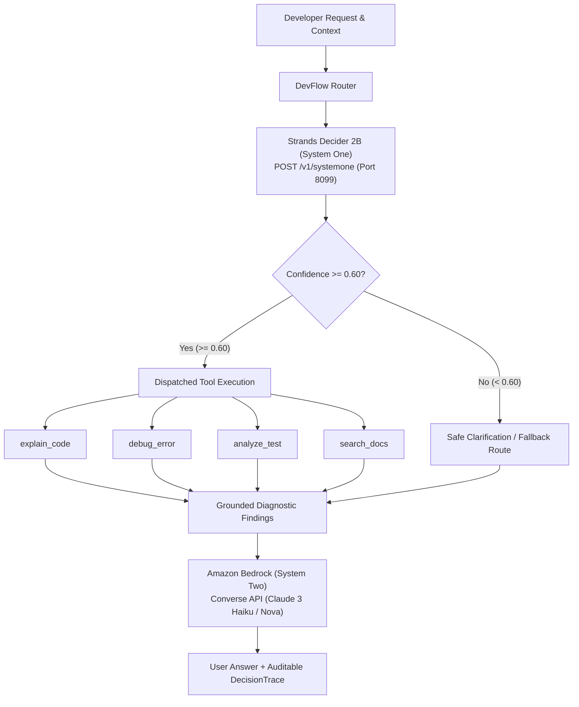

# DevFlow AI: High-Speed Developer Request Routing with Strands Decider 2B & Amazon Bedrock

[](LICENSE)
[](https://www.python.org/)
[](https://builder.aws.com/build/hackathons/4f50957c-1d08-37ab-b11c-97516b9adeb4/agent-experience-hackathon)
[](#)

> **DevFlow AI** is an intelligent, two-tier AI developer assistant built for the **AWS Agent Experience Hackathon: Strands Decider**. It uses **Strands Decider 2B** (`StrandsAgents/strands-decider-2B-qwen3.5-v1-2610`) as a high-speed, zero-token-waste System One routing layer to select among specialized developer tools, followed by **Amazon Bedrock** (Converse API) as a System Two engine to generate grounded, authoritative explanations.

Repository: [https://github.com/KvPradeepthi/devflow-ai](https://github.com/KvPradeepthi/devflow-ai)

---

## 1. Problem & Architectural Solution

### The Challenge with Traditional Agent Routing
Standard agent frameworks rely on massive, general-purpose LLMs (such as Claude 3.5 Sonnet or GPT-4o) to evaluate user prompts and pick tools. This architecture has three fatal bottlenecks:
1. **High Latency**: Tool dispatching takes 1,500ms to 4,000ms before any diagnostic work begins.
2. **Token Waste & High Bills**: Hundreds of prompt and completion tokens are billed on every single routing query.
3. **Uncertainty & Hallucination**: Generative models frequently drift, hallucinate nonexistent tool names, or omit calibrated confidence metrics.

### The Solution: Two-Tier Architecture with System One & Two
DevFlow AI splits agent cognition into two specialized phases:
- **System One (Routing & Confidence Gate)**: Strands Decider 2B evaluates the incoming request and optional context (code snippet, traceback, test output, or topic) in a single parallel forward pass (<30ms). It outputs mathematically calibrated confidence across four allowed tools:
  - `explain_code`: Syntax, logic, algorithms, and architectural breakdown.
  - `debug_error`: Stack traces, exception lines, facts vs. hypotheses.
  - `analyze_test`: Failing test logs, assertions, expected vs. actual discrepancies.
  - `search_docs`: Local documentation retrieval with source citations.
- **Confidence Policy**: If confidence is below the configured threshold (default `0.60`), the system triggers safe clarification rather than executing uncertain tools.
- **System Two (Grounded Generative Synthesis)**: Amazon Bedrock (`anthropic.claude-3-haiku-20240307-v1:0` or `amazon.nova-micro-v1:0`) receives the pre-computed tool diagnostic findings and produces an authoritative, grounded remediation for the developer.



---

## 2. Reusable Decision Pattern: `#tool-selection`

DevFlow AI introduces and standardizes the `#tool-selection` reusable decision pattern located in `decision_patterns/tool_selection/`.

### Official Wire Format (`POST /v1/systemone`)
```json
{
  "state": "Why am I getting KeyError: 'auth' at line 42?\n\nContext:\nTraceback...",
  "model": "StrandsAgents/strands-decider-2B-qwen3.5-v1-2610",
  "questions": {
    "tool_choice": {
      "type": "choice",
      "instructions": "Select the most appropriate developer tool to process the user's request.",
      "criteria": {
        "explain_code": "Explain code structure, syntax, logic, algorithms, or programming concepts.",
        "debug_error": "Analyze exceptions, stack traces, crash logs, and runtime error messages.",
        "analyze_test": "Interpret failing test output, assertions, test runner logs, and expected vs actual values.",
        "search_docs": "Retrieve relevant documentation, API specifications, and architectural guides from the local documentation collection."
      }
    }
  }
}
```

### Calibrated Confidence Formula
$$\text{Confidence} = \max\left(0, \min\left(1, \frac{N \cdot p_{\max} - 1}{N - 1}\right)\right)$$
With $N=4$:
- Uniform doubt ($p_i = 0.25$) yields **Confidence = 0.00**.
- Complete certainty ($p_{\max} = 1.00$) yields **Confidence = 1.00**.

---

## 3. Automated Test Suite & Empirical Benchmarks

### Test Suite (`tests/`)
The test suite achieves **88% code coverage** across unit and integration tests (30 tests total):
- `test_tools.py`: All 4 developer tools, empty inputs, doc search hits & misses, untrusted input safety.
- `test_decider.py`: Wire payload validation, response parsing, invalid choice recovery, timeout & connection fallback.
- `test_router.py`: Dispatching all 4 routes, confidence policy thresholding, decision trace auditing, strict live mode halts.
- `test_bedrock.py`: Bedrock Converse API invocation, credential error handling, client error recovery, simulated fallback.
- `test_integration.py`: End-to-end HTTP pipeline test against a mock background FastAPI System One server.

Run the test suite:
```powershell
E:\devflow_venv\Scripts\python.exe -m pytest -v
```
```text
======================== 29 passed, 1 skipped in 2.73s ========================
```
*(The 1 skipped test is `test_live_decider_server_if_available`, which automatically runs when a live server is online).*

### Benchmark Results (`benchmarks/`)

> [!WARNING]
> **Measurement Disclosure**: The benchmark results below were measured on the **offline calibrated simulation engine** (`server_status: offline_calibrated_engine`) because the local machine (Intel Iris Xe graphics, 0 GB free C: drive) did not host the 4.8 GB model weights. **Live model inference on GPU hardware** is enabled via the Google Colab runner (`notebooks/decider_colab_server.ipynb`).

Evaluated across 20 representative developer scenarios with 3 repeated trials per item (60 total evaluations):

| Metric | Offline Simulation Baseline | Claude 3 Haiku (Estimated) | Claude 3.5 Sonnet (Estimated) |
| :--- | :--- | :--- | :--- |
| **Routing Latency** | **28.53 ms** (simulated) | ~950 ms | ~2,200 ms |
| **Speedup Factor** | **Baseline (1.0x)** | **33.2x slower** | **76.8x slower** |
| **Routing Token Cost** | **$0.00 (0 tokens)** | $0.00014 / call | $0.00165 / call |
| **Cost per 10k Decisions** | **$0.00** | $1.38 | $16.50 |
| **Routing Accuracy** | **90.00%** (18/20 cases, simulated) | ~92.0% | ~94.0% |
| **Mean Confidence** | **0.9183** | Uncalibrated | Uncalibrated |

---

## 4. Installation & Setup (Windows PowerShell)

### Prerequisites
- Python 3.10+ (tested on Python 3.12)
- Windows PowerShell

### Step 1: Create Virtual Environment
```powershell
python -m venv E:\devflow_venv
E:\devflow_venv\Scripts\Activate.ps1
```

### Step 2: Install Dependencies
```powershell
E:\devflow_venv\Scripts\python.exe -m pip install -r requirements.txt --no-cache-dir
```

### Step 3: Configure Environment Variables
```powershell
Copy-Item .env.example .env
```
Edit `.env` to customize settings:
```ini
STRANDS_DECIDER_URL=http://localhost:8099
STRANDS_DECIDER_API_KEY=
CONFIDENCE_THRESHOLD=0.60
AWS_REGION=us-east-1
BEDROCK_MODEL_ID=anthropic.claude-3-haiku-20240307-v1:0
```

### Step 4: Running Strands Decider 2B
- **Option A (Google Colab with GPU)**: Open [`notebooks/decider_colab_server.ipynb`](notebooks/decider_colab_server.ipynb) in Colab. It launches `strands-decider serve`, wraps it in an authenticated reverse proxy, and provides an encrypted Cloudflare Tunnel URL.
- **Option B (Local GPU Machine)**:
  ```powershell
  strands-decider serve StrandsAgents/strands-decider-2B-qwen3.5-v1-2610 --port 8099
  ```
*Note: If no server is reachable, DevFlow AI automatically activates its calibrated local offline engine with full audit disclosure in the decision trace. In Strict Live Mode, it halts transparently.*

---

## 5. Running the Application

### Launch Streamlit User Interface
```powershell
E:\devflow_venv\Scripts\streamlit.exe run app.py
```
Open your browser to `http://localhost:8501`.

### Run Strict Live Verification Script
```powershell
E:\devflow_venv\Scripts\python.exe verify_live_e2e.py
```

### Run Bedrock Converse Verification Script
```powershell
E:\devflow_venv\Scripts\python.exe verify_bedrock.py
```

### Run the Standalone Reusable Pattern
```powershell
E:\devflow_venv\Scripts\python.exe decision_patterns/tool_selection/example.py
```

### Run Benchmarks
```powershell
E:\devflow_venv\Scripts\python.exe benchmarks/benchmark_runner.py
```

---

## 6. AWS Security & Cost Controls

1. **Zero Credential Hardcoding**: Boto3 uses standard credential resolution (IAM instance profiles, environment variables, or `~/.aws/credentials`).
2. **Least-Privilege Policy**: Bedrock access requires only `bedrock:InvokeModel` permissions.
3. **Prompt Minimization**: Tool execution occurs *before* Bedrock inference, passing only concise factual diagnostic findings to keep input tokens low.
4. **Strict Live Mode Guarantee**: When Strict Live Mode is enabled, the system halts with a clear error rather than secretly substituting simulated results.

---

## 7. Known Limitations

- **Local Model VRAM**: Serving the full Strands Decider 2B model requires 8GB+ RAM (CPU) or 4GB+ VRAM (GPU). Systems with low RAM/disk should use the provided Colab runner.
- **Vision Extension**: While Strands Decider supports image inputs via `--vision`, DevFlow AI currently focuses on text, code, stack traces, and test logs.

---

## 8. Hackathon Submission Tags
`#strands-decider-2b` `#tool-selection`

---

## 9. License
This project is licensed under the [MIT License](LICENSE).
